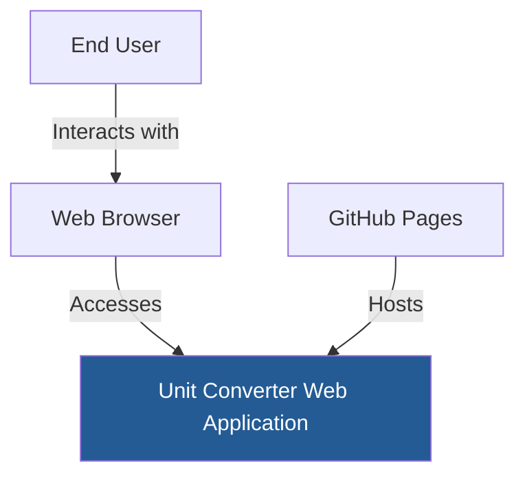
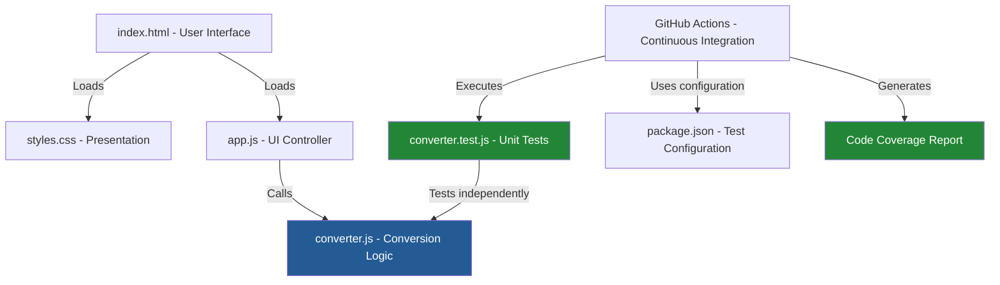
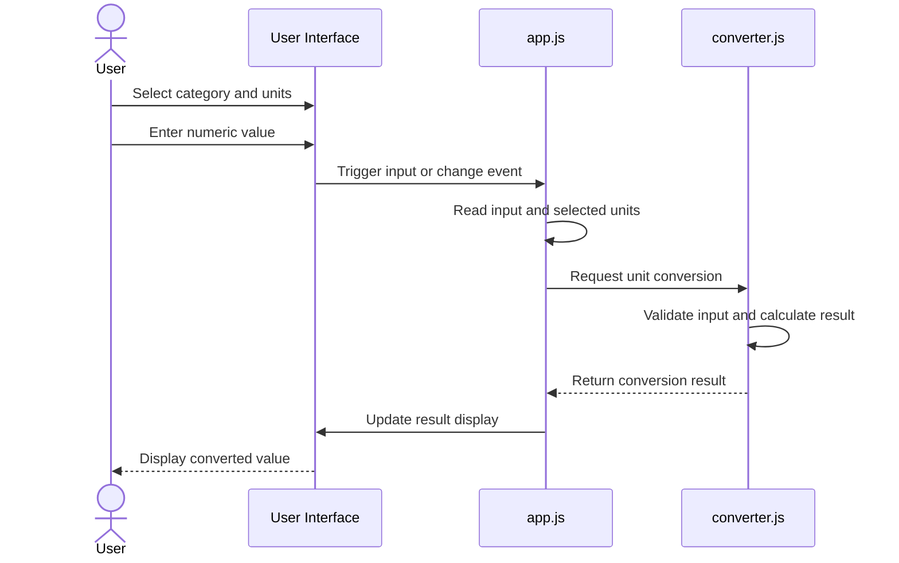
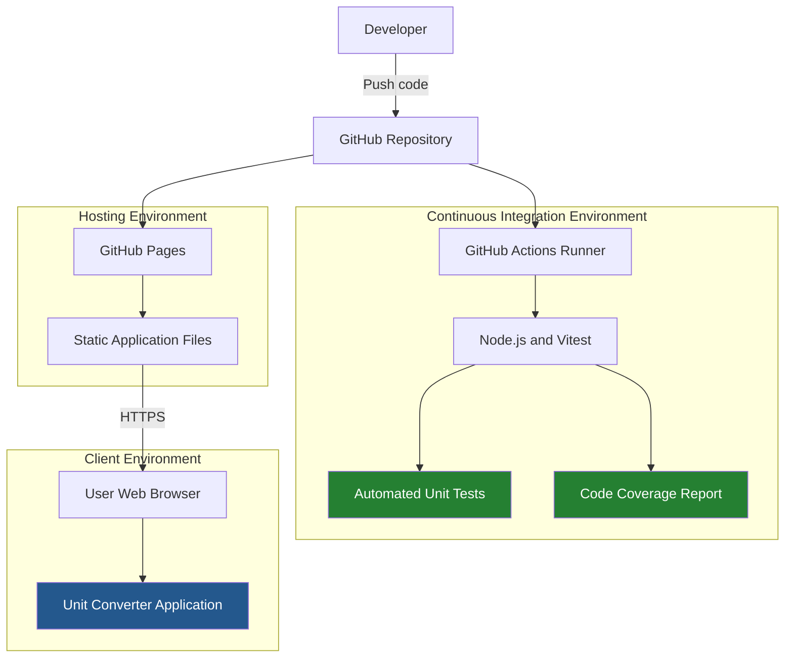

# Software Architecture Documentation

## Unit Converter with Test Suite

**Author:** Diana Carolina Salgado Ortiz  
**University:** Bay Atlantic University  
**Course:** CMPS 570 - Software Architecture  
**Quality Attribute:** Testability

## 1. Architecture Overview

The Unit Converter is a client-side web application developed
using HTML, CSS, and JavaScript.

The architecture separates the presentation layer, user
interaction logic, and core conversion logic to improve
maintainability, modularity, and testability.

The application supports five conversion categories:

- Length
- Weight
- Temperature
- Volume
- Time

## 2. System Context Diagram

The system context diagram illustrates the relationship
between the end user, the application, and its hosting platform.

The application executes conversion operations directly
in the user's browser without requiring a backend server
or database.

## 3. Component Diagram

The component diagram illustrates the separation of
responsibilities within the application.

### Component Responsibilities

| Component | Responsibility |
|---|---|
| index.html | Defines the user interface and input controls. |
| styles.css | Provides visual styling and responsive layout. |
| app.js | Handles user interaction and displays conversion results. |
| converter.js | Implements the independent conversion logic. |
| converter.test.js | Contains automated unit tests. |
| package.json | Defines dependencies and testing commands. |
| tests.yml | Configures the continuous integration workflow. |

## 4. Sequence Diagram

The sequence diagram illustrates the interaction between
components during a unit conversion.

The separation between the user interface and the conversion
module allows the conversion logic to be tested independently.

## 5. Quality Attribute: Testability

Testability is the primary quality attribute of this project.

The architecture supports testability through:

- Separation of concerns.
- Independent conversion logic.
- Automated unit testing.
- Input validation.
- Continuous integration.
- Automated code coverage measurement.

The conversion module can be tested without requiring
interaction with the graphical user interface.

## 6. Testing and Coverage Results

The automated test suite was executed using Vitest 3.2.4
with V8 code coverage.

| Metric | Minimum Target | Actual Result |
|---|---:|---:|
| Automated Tests | All passing | 29/29 |
| Statement Coverage | 80% | 100% (102/102) |
| Branch Coverage | 80% | 100% (29/29) |
| Function Coverage | 80% | 100% (3/3) |
| Line Coverage | 80% | 100% (102/102) |

All 29 automated tests passed successfully.

The conversion module exceeded the minimum coverage
requirement by 20 percentage points across all four
coverage metrics.

Coverage measurements apply specifically to converter.js,
rather than the entire application.

## 7. Continuous Integration

GitHub Actions automatically executes the unit tests and
generates a coverage report when changes are pushed to
the main branch or when pull requests target that branch.

The initial workflow execution completed successfully
in 20 seconds.

The coverage report is available as a downloadable
GitHub Actions artifact.

## 8. Project Links

- [Source Code](https://github.com/Dianac506/unit-converter-test-suite)
- [Live Application](https://dianac506.github.io/unit-converter-test-suite/)
- [Automated Testing Workflow](https://github.com/Dianac506/unit-converter-test-suite/actions)

## Deployment Diagram

The deployment diagram illustrates the physical and execution
environments of the Unit Converter application.

The application is hosted on GitHub Pages and executes entirely
within the user's web browser. Automated testing is performed
in a separate continuous integration environment using
GitHub Actions, Node.js, and Vitest.

### Deployment Components

| Component | Responsibility |
| --- | --- |
| GitHub Repository | Stores source code, tests, and architecture documentation. |
| GitHub Pages | Hosts and delivers the static web application. |
| User Web Browser | Executes the application and displays conversion results. |
| GitHub Actions Runner | Provides the automated testing environment. |
| Node.js and Vitest | Execute unit tests and measure code coverage. |
| Code Coverage Report | Provides measurable evidence of testability. |

### Deployment Architecture and Testability

The deployment architecture supports Testability by separating
the production execution environment from the automated
testing environment.

The conversion logic can be tested independently without
launching a web browser or deploying the application.

GitHub Actions automatically executes the test suite and
verifies the minimum code coverage threshold of 80%.

The application does not require a backend server or database,
reducing infrastructure complexity and external dependencies.

The successful execution of 29 automated tests and 100%
code coverage of converter.js demonstrates the effectiveness
of the independent testing environment.

The coverage results apply to the conversion logic module
This does not include coverage for the User Interface (UI).
